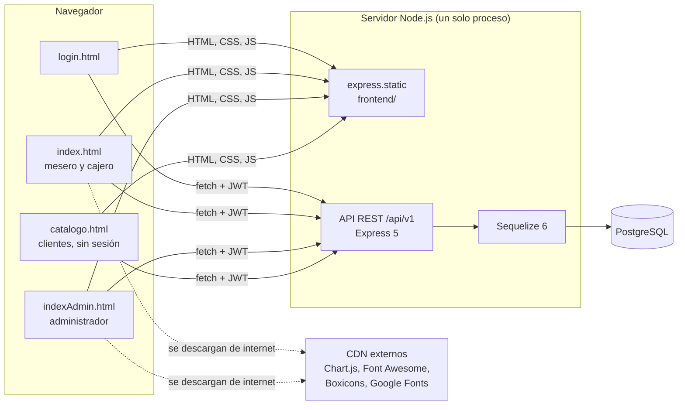
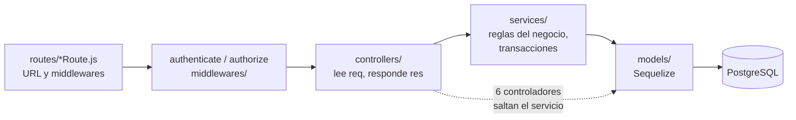
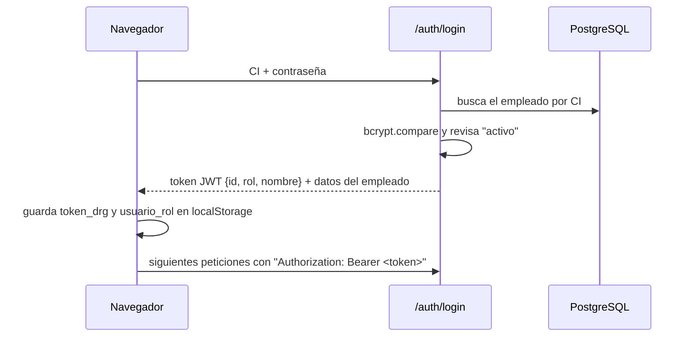

# Arquitectura de DRG – Mesa Dragón

> **25/11/2026 · Versión 0.1** · Issue #11.
> Describe el sistema **tal como está hoy** en `main`, antes de las correcciones de las Etapas 3 y 4 y de la migración a TypeScript. Las decisiones sobre cómo va a cambiar están en los [ADR](adr/README.md). El modelo de datos está en [`modelo-datos.md`](modelo-datos.md), la API en [`endpoints.md`](endpoints.md) y los permisos en [`permisos.md`](permisos.md).

## 1. Vista general

Es una aplicación web clásica de tres capas: un navegador con una SPA en JavaScript vanilla, un backend Node.js + Express que expone una API REST en `/api/v1` y una base PostgreSQL. **El mismo proceso de Express sirve el frontend como archivos estáticos y la API.**

| Pieza | Tecnología | Dónde |
|-------|------------|-------|
| Backend | Node.js 26 (fijado en `.nvmrc` y `engines`), CommonJS | `backend/src/` |
| Acceso a datos | Sequelize 6 + `pg`; migraciones y seed con `sequelize-cli` | `backend/src/models/`, `migrations/`, `seeders/` |
| Base de datos | PostgreSQL | variable `DATABASE_URL` |
| Frontend | HTML, CSS y JavaScript vanilla con módulos ES6, sin compilación | `frontend/` |
| Despliegue | Todavía no hay: `backend/docker-compose.yml` solo tiene un comentario (se completa en la Etapa 7; la instalación de desarrollo es nativa: [`instalacion.md`](../04_implementacion/instalacion.md)); la configuración de Nginx llega en la Etapa 7 | ver ADR-003 |

## 2. Backend

### 2.1 Arranque

1. `server.js` comprueba la conexión a la base (`sequelize.authenticate()`) y levanta Express en `PORT` (3000 por defecto). Si la base no responde, el proceso termina.
2. `app.js` arma la aplicación, en este orden:
   1. `cors()` abierto a cualquier origen (#69), `express.json()` y `express.urlencoded()`.
   2. `express.static(frontend/)` y `GET /`, que devuelve `html/login.html`.
   3. Las 18 rutas de la API bajo `/api/v1` (`auth`, `empleados`, `categorias`, `productos`, `juegos`, `pisos`, `mesas`, `ordenes`, `ordenes-productos`, `ordenes-juegos`, `pagos`, `clientes`, `reservas`, `comandas`, `asistencias`, `reportes`, `configuracion` e `importacion`).
   4. `notFoundHandler` y `errorHandler`.

Antes de cargar `app.js`, `server.js` llama a `validarEntorno()` (`config/env.js`), que lee `backend/.env` con `dotenv` y detiene el arranque con un mensaje claro si falta `DATABASE_URL` o `JWT_SECRET` (#14).

### 2.2 Capas

El patrón previsto es **Route → Controller → Service → Model**:

| Capa | Qué hace | Observaciones |
|------|----------|---------------|
| Rutas (`routes/`, 18 archivos) | Definen método, URL y middlewares | No hay ruta de cierre del día: se hace en #34. `configuracionRoutes.js` usa plural, a diferencia del resto |
| Middlewares (`middlewares/`) | `authenticate` (token JWT), `requierePermiso(...)` (permiso por acción, #25), `errorHandler`, `notFoundHandler` | No hay validación de entrada: llega en la Etapa 5, con Zod |
| Controladores (`controllers/`, 18) | Leen `req`, llaman al servicio y arman la respuesta | **Seis usan los modelos directamente**, sin servicio: `asistencia`, `configuracion`, `empleado`, `importacion`, `reportes` y, en parte, `juego` (`listar` no usa el servicio, por eso ignora el filtro de categoría) |
| Servicios (`services/`, 13) | Reglas del negocio y transacciones (crear orden, finalizar, pagos, descuentos, comandas, importación) | Asistencia no tiene servicio: el cálculo del atraso en el servidor llega con #29 |
| Modelos (`models/`, 24) | Definición de tablas con `sequelize.define` | Todas las asociaciones están en `models/index.js`, no en `associate()` de cada modelo. Casi todos usan borrado lógico (`paranoid`) |

### 2.3 Módulos

| Módulo | Ruta | Controlador / servicio | Tablas principales |
|--------|------|------------------------|--------------------|
| Autenticación | `/auth` | `authController` / `authService` | `empleado` |
| Empleados y horarios | `/empleados` | `empleadoController` (sin servicio) | `empleado`, `horario` |
| Asistencia | `/asistencias` | `asistenciaController` (sin servicio) | `asistencia`, `descuento_atraso`, `horario` |
| Catálogo | `/categorias`, `/productos`, `/juegos` | sus controladores y servicios | `categoria`, `producto`, `juego` y sus tablas intermedias |
| Espacio | `/pisos`, `/mesas` | sus controladores y servicios | `piso`, `mesa` |
| Órdenes | `/ordenes`, `/ordenes-productos`, `/ordenes-juegos` | `ordenService`, `contenedorProductoService`, `contenedorJuegoService` | `orden`, `contenedor_producto`, `contenedor_juego`, `descuento`, `orden_descuento` |
| Pagos | `/pagos` y `/ordenes/:id/finalizar` | `transaccionService` y `ordenService` | `contenedor_transaccion` |
| Comandas | `/comandas` | `comandaService` | `contenedor_producto` (contadores por estado) |
| Clientes y reservas | `/clientes`, `/reservas` | sus controladores y servicios | `cliente`, `reserva` |
| Reportes | `/reportes/dashboard` | `reportesController` (sin servicio) | lee órdenes, transacciones, ítems, reservas y asistencias |
| Configuración | `/configuracion` | `configuracionController` (sin servicio) | `configuracion`, `descuento_atraso` |
| Importación | `/importacion` | `importacionController` / `importacionService` | `producto`, `juego`, `categoria` |

### 2.4 Autenticación y roles

- Las contraseñas se guardan con **bcrypt**, en los *hooks* `beforeCreate` y `beforeUpdate` del modelo `Empleado`, y no se devuelven en las respuestas.
- El token dura lo que diga `JWT_EXPIRATION` y se firma con `JWT_SECRET`. Si falta `JWT_SECRET`, el backend no arranca (#14).
- `authenticate` responde **401** sin token o con un token inválido o vencido, y `requierePermiso` **403** cuando el rol no tiene el permiso de la ruta (#26, #25). En el frontend, `manejarSesion` (`js/api.js`) borra la sesión y vuelve al login ante un 401, con el motivo, y muestra un aviso ante un 403.
- `GET /empleados/perfil` devuelve el contenido del token, no los datos de la base: un empleado desactivado o con el rol cambiado sigue operando hasta que el token vence (#60).
- Hay tres roles: `ADMIN`, `CAJERO` y `MESERO`. Cada ruta pide un **permiso por acción** con `requierePermiso('...')` (ADR-008, #25); el mapa rol → permisos está en un solo archivo, `backend/src/config/permisos.js`, y el ADMIN tiene siempre todos (RN-17). Qué puede hacer cada rol está en [`permisos.md`](permisos.md), y las pruebas comprueban que el código coincide. `usuario_rol` en `localStorage` solo decide qué menú se muestra; la protección real es la del servidor.

### 2.5 Errores

`errorHandler` traduce los errores de Sequelize: validación y clave única → 400; error de base de datos → 500. Los errores de negocio se lanzan como `new Error("...")` sin código, así que salen como **500** aunque sean errores del usuario (por ejemplo "La mesa ya está ocupada"). Hay un `if` que compara el texto de un error puntual. El formato de las respuestas no es uniforme (`{message, data}`, el arreglo directo u otros). Todo esto se ordena en #68.

### 2.6 Lógica que conviene conocer

- **Total de la orden:** `utils/orderUtils.actualizarTotalOrden` lo recalcula sumando precio actual × cantidad de productos y juegos, menos los descuentos. Los ítems no guardan el precio cobrado (#22, ADR-007).
- **Estados de mesa:** la mesa pasa a ocupada (1) al abrir una orden y a libre (0) al cobrarla; las reservas próximas la marcan como reservada (3).
- **Reservas:** la expiración (`EXPIRADA`) y el cambio de estado de las mesas se recalculan **en cada consulta** de mesas y de reservas. La lógica está repetida en `reservaService` y `mesaService` (#51).
- **Comandas:** cada ítem de producto tiene contadores `cantidad_recibido`, `cantidad_preparando`, `cantidad_terminado` y `cantidad_enviado`; `POST /comandas/:id/avanzar` mueve unidades de un estado al siguiente dentro de una transacción. **Hoy ningún módulo del frontend llama a `/comandas`**: la vista de impresión lee los ítems con `/ordenes-productos`.
- **Asistencia:** el atraso y el descuento se calculan **en el navegador** (`asistencia.js`) y el servidor guarda lo que recibe (#29). La aprobación pide el CI y la contraseña de un ADMIN o CAJERO.
- **Cierre del día:** no existe en el servidor; se guarda en `localStorage` (#34).
- **Zona horaria (#27):** todo trabaja en `America/La_Paz`. `config/env.js` fija `TZ` al arrancar (para `new Date()`, `setHours`, etc.) y Sequelize usa la misma zona en la conexión (`timezone` en `config/config.js`, para `now()`, `LOCALTIME` y la conversión de un `Date` a `time`). Los días se arman con `utils/fechas.js` (`fechaLocal`, `inicioDelDia`, `finDelDia`), nunca con `toISOString()`. En el frontend, `fechaLocalISO` y `horaLocal` de `utils.js` usan `Intl` con la zona fija, sin depender de la configuración del navegador. Las columnas `timestamptz` guardan instantes y no cambian; las `time` guardan la hora del reloj de Bolivia.

## 3. Frontend

### 3.1 Páginas

| Página | Para quién | Qué carga |
|--------|------------|-----------|
| `html/login.html` | Todos | `js/login.js`: guarda el token y redirige según el rol |
| `html/index.html` | MESERO y CAJERO | `js/main.js` + vistas de mesas, toma de pedidos, impresión de comandas, reservas, clientes y asistencia |
| `html/indexAdmin.html` | ADMIN | `js/main.js` + vistas de administración y dashboard (Chart.js) |
| `html/catalogo.html` | Clientes (por QR), sin sesión | `js/catalogoCliente.js` (módulo ES desde #23), que llama a la API con una URL relativa (#14) |
| `html/cerrado.html` | Todos | Pantalla de "día cerrado" |

### 3.2 SPA casera

- `cargarHTML(ruta, callback)` (`js/utils.js`) detiene el auto-refresco, trae una de las **21 vistas parciales** de `html/` (los otros 5 archivos son las páginas de la tabla anterior) con `fetch`, la inserta con `innerHTML` en `#cuerpo` y llama a la función `init…()` del módulo.
- Los **12 módulos** de `js/modules/` (mesas, productos, órdenes, reservas, clientes, asistencia, impresión, admin…) arman la interfaz con plantillas de texto e `innerHTML`. Desde #23 todo dato de la API pasa por `escaparHTML()` (`js/utils.js`) y una regla de ESLint lo exige; el catálogo solo abre enlaces `http(s)` (`urlSegura()`).
- `js/api.js` tiene `authFetch()`, que agrega el token y vuelve al login ante un 401.
- `iniciarAutoRefresco()` vuelve a pedir los datos de la vista cada 30 segundos y se detiene al cambiar de vista.
- El estado compartido vive en variables de los módulos (por ejemplo `ORDEN_ACTUAL_ID`) y en `sessionStorage` (`mesaSeleccionada`).
- **Impresión de comandas:** `imprimir-comanda.html` muestra los tickets por zona y usa `window.print()` del navegador (ADR-006).

### 3.3 Estilos y dependencias

- 16 hojas de estilo; cada vista parcial trae la suya con un `<link>`, y las hojas se van acumulando. Hay cuatro `:root` con variables distintas que se pisan entre sí (#71, #72).
- Chart.js, Font Awesome, Boxicons y Google Fonts se cargan **desde internet** (ADR-002).
- **Imágenes:** las fotos de productos y juegos están en `frontend/assets/imagenes/` y `assets/productos/` tiene solo las imágenes por defecto (`default-*.png`). `producto.imagen` y `juego.imagen` guardan el nombre del archivo (o una URL, o la imagen subida como `data:`). Las tres pantallas que las muestran (POS, panel del admin y catálogo de clientes) arman la ruta con `rutaImagen()` de `utils.js` (#96).

## 4. Configuración y entorno

| Variable | Para qué | Observación |
|----------|----------|-------------|
| `DATABASE_URL` | Conexión que usan `sequelize-cli` (migraciones y seed) y la app | Obligatoria. `config/config.js` es la única fuente: lo leen `sequelize-cli` y `models/index.js` (#14) |
| `PORT` | Puerto de Express | 3000 por defecto |
| `JWT_SECRET`, `JWT_EXPIRATION` | Firma y duración del token | `JWT_SECRET` es obligatoria; `JWT_EXPIRATION` vale `8h` si falta (#14) |

`.sequelizerc` apunta `sequelize-cli` a `src/config/config.js`, `src/models`, `src/migrations` y `src/seeders`. Las variables están documentadas en `backend/.env.example` (#14).

## 5. Cómo va a cambiar

| Tema | Hoy | Después | Dónde se decide |
|------|-----|---------|-----------------|
| Lenguaje | JavaScript | TypeScript gradual + Zod | ADR-001 |
| Frontend | Archivos sueltos y CDN | Vanilla + Vite, dependencias empaquetadas | ADR-002 |
| Despliegue | Ninguno | Docker Compose en la PC del local | ADR-003 |
| Respaldos | Ninguno | `pg_dump` diario y copia externa | ADR-004 |
| Clientes de la API | Web | Web + app de meseros | ADR-005 |
| Impresión | `window.print()` | Servicio de impresión en el servidor | ADR-006 |
| Precio de juegos | Por juego, recalculado | Por tamaño, guardado en el ítem | ADR-007 |
| Permisos | Listas de roles escritas en cada ruta (`authorize`) | Permisos por acción (`requierePermiso`), con el mapa en código y, si el dueño lo pide, editable desde el panel | ADR-008 |

Este documento se actualiza cuando termine cada etapa que cambie la arquitectura (por lo menos al cerrar la Etapa 5).
