# Modelo de datos de DRG – Mesa Dragón

> **25/11/2026 · Versión 0.1** · Issue #11.
> Describe la base **tal como la dejan las migraciones de `main`** (36 migraciones, de noviembre de 2025 a junio de 2026). No sale de los modelos de Sequelize porque en varios puntos no coinciden con la base real (ver la sección 5).

## Cómo se obtuvo

1. Se corrieron las 36 migraciones con `npx sequelize-cli db:migrate` en una base PostgreSQL 16 vacía. Todas pasan.
2. Se leyó el esquema resultante de `information_schema` y `pg_catalog`: tablas, columnas, tipos, nulos, valores por defecto, claves primarias, claves únicas y claves foráneas con su regla de borrado.
3. El diagrama de la sección 2 se **generó** a partir de esa consulta, no se dibujó a mano.

Para repetirlo, después de migrar una base vacía:

```sql
SELECT table_name, column_name, data_type, is_nullable, column_default
FROM information_schema.columns
WHERE table_schema = 'public'
ORDER BY table_name, ordinal_position;
```

## 1. Convenciones

- **Nombres de tabla** en `snake_case` y en singular (`orden`, `contenedor_producto`). Las columnas también, salvo `mesa.cantidadMinima` y `mesa.cantidadMaxima` (en `camelCase`) y las marcas de tiempo.
- **Marcas de tiempo:** todas las tablas tienen `createdAt` y `updatedAt` (`timestamptz`, en `camelCase`). No se muestran en el diagrama.
- **Borrado lógico:** todas las tablas menos `configuracion`, `producto_categoria` y `juego_categoria` (desde #78) tienen `deletedAt` (Sequelize `paranoid`): borrar pone la fecha y la fila sigue en la base. Tampoco se muestra en el diagrama.
- **Claves:** `id` entero autoincremental (`SERIAL`) en las tablas principales; clave primaria **compuesta** en las tablas intermedias (`juego_categoria`, `producto_categoria`, `orden_descuento` y las `registro_*`).
- **Dinero** en `numeric` sin precisión fija (`orden.total`, `producto.precio`, `juego.precio`, `descuento.monto`, `contenedor_transaccion.cantidad`).

## 2. Diagrama entidad-relación

`PK` clave primaria · `FK` clave foránea · `UK` única · `"NULL"` admite nulos. Una línea `|o--o{` indica que la clave foránea admite nulos.

```mermaid
erDiagram
    descuento_atraso |o--o{ asistencia : "descuento_id"
    empleado ||--o{ asistencia : "empleado_id"
    horario ||--o{ asistencia : "horario_id"
    juego ||--o{ contenedor_juego : "juego_id"
    orden ||--o{ contenedor_juego : "orden_id"
    orden ||--o{ contenedor_producto : "orden_id"
    producto ||--o{ contenedor_producto : "producto_id"
    cliente |o--o{ contenedor_transaccion : "cliente_id"
    orden |o--o{ contenedor_transaccion : "orden_id"
    empleado ||--o{ horario : "empleado_id"
    categoria ||--o{ juego_categoria : "categoria_id"
    juego ||--o{ juego_categoria : "juego_id"
    piso |o--o{ mesa : "piso_id"
    mesa |o--o{ orden : "mesa_id"
    descuento ||--o{ orden_descuento : "descuento_id"
    orden ||--o{ orden_descuento : "orden_id"
    categoria ||--o{ producto_categoria : "categoria_id"
    producto ||--o{ producto_categoria : "producto_id"
    asistencia ||--o{ registro_asistencia : "atraso_id"
    registro ||--o{ registro_asistencia : "registro_id"
    orden ||--o{ registro_orden : "orden_id"
    registro ||--o{ registro_orden : "registro_id"
    registro ||--o{ registro_reserva : "registro_id"
    reserva ||--o{ registro_reserva : "reserva_id"
    cliente ||--o{ reserva : "cliente_id"
    mesa ||--o{ reserva : "mesa_id"
    asistencia {
        int id PK
        int empleado_id FK
        int descuento_id FK
        timestamptz fecha_hora_llegada
        bool aprobado
        int horario_id FK
        varchar estado
    }
    categoria {
        int id PK
        varchar nombre
    }
    cliente {
        int id PK
        varchar nombre
        varchar ci "NULL"
        varchar telefono "NULL"
    }
    configuracion {
        int id PK
        varchar clave UK
        int valor
        varchar descripcion "NULL"
    }
    contenedor_juego {
        int id PK
        int orden_id FK
        int juego_id FK
        time hora_inicio
        time hora_fin "NULL"
        int cantidad
        numeric precio_unitario
        varchar comentario "NULL"
    }
    contenedor_producto {
        int id PK
        int orden_id FK
        int producto_id FK
        int cantidad
        int cantidad_recibido
        int cantidad_preparando
        int cantidad_terminado
        int cantidad_enviado
        numeric precio_unitario
        varchar comentario "NULL"
    }
    contenedor_transaccion {
        int id PK
        int orden_id FK
        int cliente_id FK
        timestamptz fecha
        bool activo
        numeric cantidad
        varchar tipo
    }
    descuento {
        int id PK
        int porcentaje
        numeric monto
        varchar comentario "NULL"
    }
    descuento_atraso {
        int id PK
        time cantidad_tiempo
        int descuento
        int descuento_porcentual
    }
    empleado {
        int id PK
        varchar nombre
        varchar ci UK
        varchar telefono "NULL"
        varchar contrasenia
        varchar rol
        bool activo
        varchar direccion "NULL"
        varchar correo "NULL"
    }
    horario {
        int id PK
        varchar dia
        time hora_entrada
        time hora_salida "NULL"
        int empleado_id FK
    }
    juego {
        int id PK
        varchar nombre
        numeric precio
        varchar imagen "NULL"
        int jugadores_min
        int jugadores_max
        bool activado
        int tiempo_partida
        varchar enlace "NULL"
    }
    juego_categoria {
        int juego_id PK,FK
        int categoria_id PK,FK
    }
    mesa {
        int id PK
        varchar nombre
        int numero
        int estado
        int piso_id FK
        int cantidadMinima
        int cantidadMaxima
        bool activo
    }
    orden {
        int id PK
        numeric total
        bool finalizado
        int mesa_id FK
        text notas "NULL"
    }
    orden_descuento {
        int orden_id PK,FK
        int descuento_id PK,FK
    }
    piso {
        int id PK
        varchar nombre
        int numero
        bool activo
    }
    producto {
        int id PK
        varchar nombre
        varchar zona
        bool activado
        numeric precio
        bool estado
        varchar imagen "NULL"
    }
    producto_categoria {
        int producto_id PK,FK
        int categoria_id PK,FK
    }
    registro {
        int id PK
        timestamptz fecha
    }
    registro_asistencia {
        int registro_id PK,FK
        int atraso_id PK,FK
    }
    registro_orden {
        int registro_id PK,FK
        int orden_id PK,FK
    }
    registro_reserva {
        int registro_id PK,FK
        int reserva_id PK,FK
    }
    reserva {
        int id PK
        int cliente_id FK
        timestamptz hora
        int mesa_id FK
        enum estado
    }
```



## 3. Tablas por área

### Salón

| Tabla | Para qué | Notas |
|-------|----------|-------|
| `piso` | Pisos del local | `numero`, `nombre`, `activo` |
| `mesa` | Mesas de cada piso | `estado` entero: **0 libre, 1 ocupada, 3 reservada** (no hay 2; RF-05 "sucia" se descartó). Capacidad en `cantidadMinima` y `cantidadMaxima`. `piso_id` admite nulos y queda en `NULL` si se borra el piso. No hay ninguna regla que impida números repetidos en un piso (#48) |

### Catálogo

| Tabla | Para qué | Notas |
|-------|----------|-------|
| `categoria` | Categorías de productos y de juegos | Una sola tabla para los dos |
| `producto` | Comida y bebida | `zona` es texto libre (`COCINA`, `CAFETERIA`, `Barra`…: #32). Tiene **dos** booleanos, `activado` y `estado`, sin un propósito claro (#53) |
| `juego` | Juegos de mesa | `precio` propio por juego (pasa a tamaños: ADR-007), jugadores mínimo y máximo, `tiempo_partida` en minutos, `enlace` a las reglas |
| `producto_categoria`, `juego_categoria` | Relación N a N con `categoria` | Clave primaria compuesta y **sin** borrado lógico: quitar una categoría borra la fila, así que se puede volver a asignar (#78) |

### Órdenes y pagos

| Tabla | Para qué | Notas |
|-------|----------|-------|
| `orden` | Cuenta abierta de una mesa | `total` (se recalcula con precios actuales, #22), `finalizado`, `notas`. `mesa_id` admite nulos. No guarda qué empleado la abrió (#46) |
| `contenedor_producto` | Productos de una orden | `cantidad`, `comentario` y los contadores de la comanda: `cantidad_recibido`, `cantidad_preparando`, `cantidad_terminado`, `cantidad_enviado`. `precio_unitario` (`numeric(10,2)`): precio cobrado por unidad, fijado al agregar el ítem (#22, ADR-007) |
| `contenedor_juego` | Juegos prestados en una orden | `cantidad`, `comentario`, `hora_inicio` y `hora_fin` (tipo `time`, sin fecha ni zona horaria: #27). `precio_unitario` (`numeric(10,2)`): precio cobrado por unidad, fijado al agregar el juego (#22, ADR-007) |
| `descuento` | Un descuento aplicado | `porcentaje` y `monto` (los dos obligatorios; el que no se usa va en 0) y `comentario` opcional (pasa a obligatorio: #39). Se crea uno por cada vez que se aplica |
| `orden_descuento` | Relación entre la orden y sus descuentos | Clave primaria compuesta y borrado lógico |
| `contenedor_transaccion` | Pagos de una orden | `tipo` (`EFECTIVO` o `QR`, texto libre), `cantidad`, `fecha`, `activo` y `cliente_id` opcional. Anular un pago hace un borrado lógico; `activo` se guarda siempre en `true`. `orden_id` admite nulos y queda en `NULL` si se borra la orden |

### Clientes y reservas

| Tabla | Para qué | Notas |
|-------|----------|-------|
| `cliente` | Clientes que reservan | `nombre`, `ci` y `telefono` opcionales. **El CI no es único en la base**: solo lo valida el servicio, y solo al crear (#64) |
| `reserva` | Reserva de una mesa | `hora` (`timestamptz`), `estado` ENUM `PENDIENTE`, `LLEGO`, `CANCELADA`, `EXPIRADA`. No guarda la cantidad de personas (#40) |

### Personal

| Tabla | Para qué | Notas |
|-------|----------|-------|
| `empleado` | Usuarios del sistema | `ci` único (pero admite nulos), `contrasenia` con hash bcrypt, `rol` como texto (`ADMIN`, `CAJERO`, `MESERO`), `activo`, `direccion` y `correo` |
| `horario` | Horario de cada empleado por día | `dia` como texto, `hora_entrada` obligatoria, `hora_salida` opcional (hoy se descarta: #61) |
| `asistencia` | Llegada de un empleado | `fecha_hora_llegada`, `estado` (`PRESENTE`, `FALTA`, `PERMISO`, validado solo en el modelo), `aprobado`, `horario_id` obligatorio y `descuento_id` opcional |
| `descuento_atraso` | Tabla de descuentos por atraso | `cantidad_tiempo` (tipo `time`), `descuento` y `descuento_porcentual`. El seed carga la tabla RN-01: desde `00:10:00` −10 %, desde `00:20:00` −20 % y desde `00:25:01` −100 % (`cantidad_tiempo` es el atraso mínimo, inclusive). El cálculo en el servidor llega con #29 |

### Configuración y bitácora

| Tabla | Para qué | Notas |
|-------|----------|-------|
| `configuracion` | Valores que el personal puede ajustar | `clave` única, `valor` entero. Claves en uso: `ventana_bloqueo`, `minutos_tolerancia` y `ventana_llegada`. El seed las carga con 120, 30 y 30 minutos (valor de prueba de RN-12, RN-02 y decisión de Marcelo del 25/11, #13 y #98); si no existen, el código usa 120, 20 y 30 minutos (#51) |
| `registro`, `registro_orden`, `registro_reserva`, `registro_asistencia` | Pensadas como bitácora | **Nada las llena** (#66). En `registro_asistencia` la clave hacia `asistencia` se llama `atraso_id`, un nombre confuso |

## 4. Reglas de borrado de las claves foráneas

Hoy casi todo usa borrado lógico, así que estas reglas casi no se activan. Importan si alguna vez se borra algo **físicamente** (por ejemplo, hoy `DELETE /asistencias/:id` hace un borrado físico, #30).

| Al borrar… | Pasa con… | Regla |
|------------|-----------|-------|
| `piso` | `mesa.piso_id` | `SET NULL` |
| `mesa` | `orden.mesa_id` | `SET NULL` |
| `mesa` | sus `reserva` | `CASCADE` (se borran) |
| `orden` | `contenedor_transaccion.orden_id` | `SET NULL` (el pago queda sin orden) |
| `orden` | `contenedor_producto`, `contenedor_juego`, `orden_descuento` | `CASCADE` |
| `cliente` | sus `reserva` | `CASCADE` |
| `cliente` | `contenedor_transaccion.cliente_id` | `SET NULL` |
| `empleado` | sus `horario` y `asistencia` | `CASCADE` |
| `horario` o `descuento_atraso` | las `asistencia` que los usan | `CASCADE`: borrar físicamente una fila de la tabla de atrasos borraría todas las asistencias con ese descuento (#28) |
| `producto`, `juego`, `categoria` | sus ítems de orden y sus relaciones | `CASCADE` |

## 5. Diferencias entre la base y los modelos de Sequelize

| Dónde | En la base | En el modelo | Consecuencia | Issue |
|-------|-----------|--------------|--------------|-------|
| `mesa.nombre` | NOT NULL | opcional | Crear una mesa sin nombre da 500 | #28 |
| `asistencia.horario_id` | NOT NULL | opcional | Registrar una llegada sin horario ese día da 500 | #28 |
| `empleado.direccion` | existe | no existe | La dirección se descarta sin aviso | #28 |
| `orden.finalizado` | por defecto `true` | por defecto `false` | La app siempre manda `false`, pero un `INSERT` directo en SQL crearía órdenes ya cerradas | #28 |
| `asistencia.aprobado` | por defecto `true` | por defecto `false` | Igual: un `INSERT` directo crearía asistencias aprobadas | #28 |
| `asistencia.estado` | texto libre | lista de valores (`PRESENTE`, `FALTA`, `PERMISO`) | Solo la app valida los valores | #28 |
| `contenedor_transaccion.tipo`, `producto.zona`, `empleado.rol` | texto libre | sin lista de valores | Ni la base ni la app limitan los valores: por ejemplo, conviven zonas `COCINA` y `Barra` | #28, #32 |

## 6. Próximos cambios previstos

| Cambio | Issue / ADR |
|--------|-------------|
| Tabla `tamano_juego` y `juego.tamano_id`; se elimina `juego.precio` | #37, ADR-007 |
| Tabla de jornadas (apertura, cierre y reapertura del día) | #34, #35 |
| Empleado que abre la orden y que registra cada pago o descuento | #46, #39 |
| Cantidad de personas en `reserva` | #40 |
| Unicidad de llegada por empleado y día; número de mesa único por piso | #30, #48 |
| Zonas de producto como lista cerrada | #32 |
| Tabla de tickets de impresión | ADR-006, #67 |

## Historial

| Versión | Fecha | Cambio |
|---------|-------|--------|
| 0.1 | 25/11/2026 | Primera versión, a partir de las migraciones de `main` (issue #11) |
| 0.2 | 25/11/2026 | `precio_unitario` en `contenedor_producto` y `contenedor_juego` (#22) |
